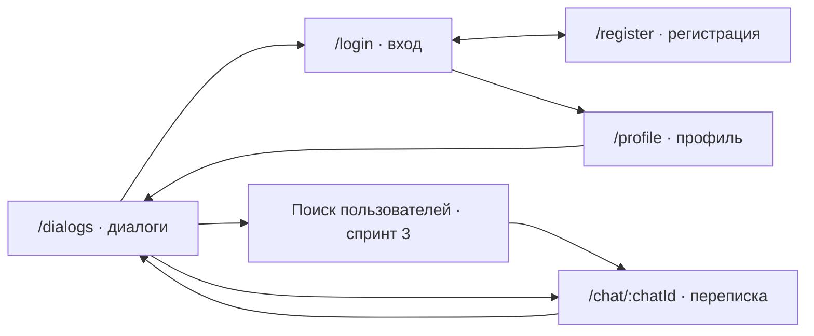

# Архитектура и карта экранов

Спринт 1, подготовлено 27.10.2026. Архитектура простая: React → HTTP API FastAPI → PostgreSQL.
Nginx отдаёт собранный интерфейс и проксирует `/api/*` в backend без префикса `/api`.
При локальной разработке ту же роль выполняет proxy Vite. Браузеру не нужен адрес контейнера.

## Решения

- Python 3.12, FastAPI: валидация и OpenAPI `/docs` из кода; синхронные обработчики БД.
- SQLAlchemy 2 + psycopg; схема изменяется только миграциями Alembic.
- Модули `auth`, `users`, `chats`, `messages`, `search`; пока они пусты, бизнес-функции появятся во следующих спринтах.
- React 19, TypeScript, Vite; React Router для маршрутов, обычный fetch в `src/api.ts`.
- Локальное состояние через React hooks. Общий auth context появится во втором спринте; Redux пока не нужен.
- PostgreSQL 16 хранит данные в именованном Docker volume.
- `/health` проверяет процесс, `/ready` — соединение с PostgreSQL. Ошибка БД не ломает liveness.
- Секреты Pyrus относятся к управлению проектом, приложению мессенджера они не нужны.

## Экраны

`/` показывает экран входа, `/dialogs` — пустое окно переписки. Неизвестный маршрут — страница 404.
Сейчас profile — публичная заглушка без персональных данных. Защита маршрута и сессия — спринт 2.
Формы disabled, фиктивные аккаунты и сообщения не подставляются.

| Экран | Загрузка | Пусто | Ошибка |
|---|---|---|---|
| Оболочка | Проверка `/api/health`, таймаут 5 с | Список без диалогов | Нет соединения + повторная проверка |
| Вход/регистрация, S2 | Кнопка заблокирована на время запроса | Поля формы | Ошибка валидации, неверные данные, недоступный API |
| Диалоги, S3 | Скелетон списка | Приглашение найти собеседника | Повторить запрос |
| Переписка, S3 | Первая страница истории | Первое сообщение | Текст сохраняется при неудачной отправке |
| Профиль, S2 | Загрузка текущего пользователя | Переход на вход без сессии | Ошибка с повтором |

## Потоки будущих спринтов

Регистрация → нормализация username/email → хеш пароля → уникальный пользователь.
Вход → проверка хеша → сессия → запрос текущего пользователя → профиль.
Поиск пользователя → выбор собеседника → сортировка пары UUID → создание или получение личного чата.
Отправка → проверка членства → сохранение сообщения → ответ → обновление истории.
WebSocket в S4 добавит события после сохранения; PostgreSQL остаётся источником истории.

Каждый запрос к сообщениям, истории и поиску должен проверять членство текущего пользователя.
UUID чата сам по себе права доступа не предоставляет. Ошибки имеют формат
`{"error":{"code":"http_404","message":"Not Found"}}`; неожиданные ошибки не раскрывают SQL и секреты.

## Обзор командой

Все семь участников должны отдельно пройти потоки выше и объяснить свой модуль и соседний.
Подтверждения обзора пока не собраны. Само наличие этой страницы не закрывает критерий командного знакомства.

Использованные справочники: [FastAPI](https://fastapi.tiangolo.com/tutorial/testing/),
[SQLAlchemy](https://docs.sqlalchemy.org/en/20/orm/quickstart.html), [Vite](https://vite.dev/guide/).

## Визуальное решение MVP

По макетам команды: светло-зелёная боковая панель, белая рабочая область,
простые рамки, Arial и стандартные поля/кнопки. На входе — центральная форма,
в профиле — круг аватара, имя и описание; в переписке — область истории и поле сообщения.
Мобильная версия складывает панели вертикально. Без внешних шрифтов, теней и декоративных иллюстраций.
В текущем каркасе формы и отправка отключены, реальные аккаунты/переписка появятся в S2/S3.
